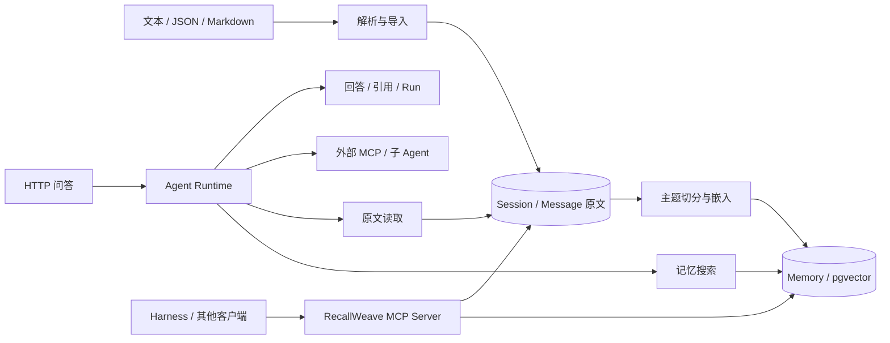

# RecallWeave

**保留原文、按需检索、能够追溯依据的个人记忆 Agent。**

RecallWeave 将聊天记录和 Markdown 文档保存为原始消息，再提炼为带有消息区间的记忆。回答历史问题时，Agent 可以先检索记忆，再读取原文；后端根据实际取回的消息生成结构化引用。它也可以通过 MCP 给外部 Agent 提供记忆，或调用外部 MCP 工具完成研究任务。

技术栈：Go · Gin · GORM · PostgreSQL · pgvector · OpenAI 兼容模型接口 · MCP · SSE。

当前定位是**面向本地个人使用的后端工程原型**。`frontend/my-app` 为独立的 React/Vite 初始工程，尚未接入后端。普通 HTTP API 暂无用户登录与租户隔离，默认监听 `127.0.0.1:8008`；远程使用需要在入口层配置访问控制。

## 阅读导航

- [已有能力](#已有能力)
- [快速启动](#快速启动)
- [完成一次导入与查询](#完成一次导入与查询)
- [配置与环境变量](#配置与环境变量)
- [HTTP API](#http-api)
- [Agent 与后台任务](#agent-与后台任务)
- [MCP 接入](#mcp-接入)
- [DeepSeek Harness 与二次开发](#deepseek-harness-与二次开发)
- [架构与源码入口](#架构与源码入口)
- [测试与验证](#测试与验证)
- [排障与已知边界](#排障与已知边界)

## 已有能力

| 能力 | 当前行为 |
| --- | --- |
| 导入资料 | 文本、ChatGPT 官方 JSON、Markdown 文档/聊天导出、ZIP 中选中的文本文件 |
| 原文保留 | Session 保存导入内容，Message 用会话内 Seq 排序，Memory 指向原文区间 |
| 记忆提炼 | 按批切分主题，区分事实、偏好、决定、任务和问题；支持增量提炼及降级 |
| 混合检索 | 关键词与 pgvector 余弦近邻两路召回，经活跃度重排和 RRF 融合后取 Top-K |
| 独立检索 | `GET /api/memories/search`，无聊天模型也可查关键词并取得原文位置 |
| 溯源问答 | 工具循环；引用只覆盖实际读取并与记忆区间相交的原始消息 |
| 生命周期 | 停用过时记忆，默认搜索排除 inactive；保留历史，限制整体重写 |
| 对话分支 | 从消息序号创建分支，保存继承快照并限制分支问答中的记忆可见范围 |
| 运行追踪 | 保存 Run、工具参数/结果、错误、模型用量、耗时与父子关系 |
| 子 Agent | researcher/reviewer、同步/后台委派、任务组、续接、取消和结果投递 |
| 后台通知 | SSE 持久化事件、游标续传与消息来源信息 |
| Skill 与产物 | 按需加载技能及参考文件；通过工具保存用户要求的文本产物 |
| 对外 MCP | stdio 与带 Bearer 鉴权的 Streamable HTTP，默认只读 |
| 外部工具 | 多个 HTTP MCP 服务、显式工具白名单、服务命名空间和独立令牌 |
| 增量写回 | stdio 显式开启 `-enable-import` 后，追加选定原始消息并支持安全重试 |

结构化引用表示“读取了这些原文”，不表示原文中的说法已获外部事实核验。当前没有可对外宣称的通用回答准确率或生产 SLA。

## 快速启动

### 依赖与启动

- Go **1.26.1 或兼容的新版本**，以 [go.mod](go.mod) 为准。
- PostgreSQL 与 pgvector；可用仓库的 [compose.yaml](compose.yaml) 启动数据库，也可使用已有实例。
- 可选：支持工具调用的 OpenAI 兼容聊天模型，以及兼容的嵌入模型。
- 运行前端初始工程或 DeepSeek Harness 才需要 Node.js，Go 后端不依赖 Node.js。

进入仓库根目录，执行以下 PowerShell 命令：

```powershell
# 仅首次创建配置；已有配置请保留并对照示例补齐字段。
if (-not (Test-Path config/config.yaml)) {
    Copy-Item config/config.example.yaml config/config.yaml
}
docker compose up -d --wait postgres
go mod download
go build ./cmd/...
go test ./cmd/... ./internal/... -count=1 -timeout 90s
go run ./cmd/server -config config/config.yaml
```

示例数据库为 `localhost:5434/recallweave`，用户 `postgres`、本地开发密码 `recallweave-local`。Compose 只绑定本机端口，数据保存在 named volume。已有配置中的数据库名、端口和密码必须与实例一致。

首次启动检查 pgvector 扩展，执行 GORM 建表/迁移并创建 HNSW 索引。账号需要对应权限；受限实例可由管理员预先执行 `CREATE EXTENSION IF NOT EXISTS vector`。安装方式见 [pgvector 官方说明](https://github.com/pgvector/pgvector#installation)。

另开终端检查：

```powershell
Invoke-RestMethod http://127.0.0.1:8008/healthz
```

返回 `{"status":"ok"}` 表示 HTTP 可响应；该接口不检查数据库和模型当前是否可用。

### 无模型与有模型两种模式

API key 留空也能启动：可以导入、按批保留原文生成兜底记忆，并使用关键词检索。问答接口返回 `503`。

完整 Agent 问答需要在**启动 Go 的同一终端**配置模型：

```powershell
$env:RECALLWEAVE_LLM_API_KEY = '<your-model-api-key>'
$env:RECALLWEAVE_LLM_BASE_URL = 'https://api.siliconflow.cn/v1'
$env:RECALLWEAVE_LLM_MODEL = '<your-tool-calling-chat-model>'
$env:RECALLWEAVE_EMBEDDING_MODEL = '<your-compatible-embedding-model>'
go run ./cmd/server -config config/config.yaml
```

按实际提供商替换模型名，示例中的名称不保证在所有账号/平台可用。聊天和嵌入目前共用 `llm.base_url` 与 `llm.api_key`；只用聊天时可将 `embedding_model` 留空。

当前支持入库 1536 维向量，或按现有策略截取前 1536 维并归一化的 4096 维输出。其他维度不会写入向量。切换嵌入模型前需核对维度和截断适用性；相同维度不代表不同模型向量可以混用。

Linux/macOS 可用 `cp` 创建配置，用 `export RECALLWEAVE_LLM_API_KEY='...'` 导出变量，其余 Go 与 Docker 命令相同。

前台 Go 进程用 `Ctrl+C` 退出，会尝试停止 worker 并关闭 HTTP。`docker compose stop` 停止数据库并保留数据；`docker compose down` 也保留 named volume，添加 `-v` 则会删除数据库数据。

## 完成一次导入与查询

下面的导入和关键词检索不需要模型 key。在服务启动后执行：

```powershell
$base = 'http://127.0.0.1:8008'
$body = @{
    source_tag = 'codex'
    name = '数据库选型'
    format = 'markdown'
    text = "# 项目决定`n`n项目使用 PostgreSQL 保存消息，使用 pgvector 检索记忆。"
} | ConvertTo-Json
$import = Invoke-RestMethod -Method Post -Uri "$base/api/imports" `
    -ContentType 'application/json; charset=utf-8' -Body ([Text.Encoding]::UTF8.GetBytes($body))
$sessionId = $import.sessions[0].session_id
Invoke-RestMethod "$base/api/sessions/$sessionId"
```

HTTP 导入先保存资料，再异步提炼；`201` 与 `extract_status: pending` 表示已受理，**不表示提炼已经完成**。稍后查询 Session 的 `extract_status`：`pending`、`done`、`failed` 或 `skipped`。查看 `extract_error` 排查失败。

状态完成后检索并查看原文：

```powershell
$keyword = [Uri]::EscapeDataString('PostgreSQL')
$hits = Invoke-RestMethod "$base/api/memories/search?q=$keyword&limit=5"
$hits.memories
Invoke-RestMethod "$base/api/sessions/$sessionId/messages"
Invoke-RestMethod "$base/api/sessions/$sessionId/memories"
```

结果的 `session_id`、`seq_start`、`seq_end` 定位原始消息。此检索接口不增加记忆召回计数。

启用聊天模型后，创建对话并提问：

```powershell
$conversation = Invoke-RestMethod -Method Post -Uri "$base/api/conversations/create" `
    -ContentType 'application/json' -Body '{"title":"RecallWeave demo"}'
$conversationId = $conversation.id
$question = @{ question = '我之前决定使用什么数据库？请核对原文并说明依据。' } | ConvertTo-Json
$answer = Invoke-RestMethod -Method Post -Uri "$base/api/chat/$conversationId" `
    -ContentType 'application/json; charset=utf-8' -Body ([Text.Encoding]::UTF8.GetBytes($question))
$answer
Invoke-RestMethod "$base/api/runs/$($answer.run_id)"
```

回答包含 `answer`、`citations`、`rounds`、`run_id`、`usage`、`timings`。引用是否存在取决于这次运行是否真正查到并核对原文；普通知识问答允许不查历史。

文件上传使用 multipart：

```powershell
# 使用 curl.exe，避免 PowerShell 中同名别名的差异。
curl.exe -X POST http://127.0.0.1:8008/api/imports/file -F source_tag=codex -F format=markdown -F "file=@notes.md"
curl.exe -X POST http://127.0.0.1:8008/api/imports/file -F source_tag=chatgpt -F "file=@conversations.json"
```

`format` 为 `auto`（也可省略）或 `markdown`，独立于 `source_tag`。Markdown 支持普通文档以及成对 User/Assistant 标题的聊天导出。ZIP 优先选 `conversations.json`，否则只读取首个可识别文本条目，不批量导入整个压缩包。

来源标签包括 `wx`、`qq`、`weibo`、`twitter`、`facebook`、`instagram`、`youtube`、`tiktok`、`cursor_ide`、`cursor_agent`、`codex`、`chatgpt`、`deepseek_harness`。**标签不代表已有对应平台专用解析器**：ChatGPT 官方 JSON 有专用解析，其他来源默认按文本处理。`chat` 是内部聊天来源，不应作为外部导入标签。

## 配置与环境变量

完整示例见 [config/config.example.yaml](config/config.example.yaml)。优先级：内置默认值 → YAML → 进程环境变量；显式空字符串也会覆盖 YAML，可用来关闭 key 或嵌入模型。

两个入口均支持 `-config`。未传时读取 `RECALLWEAVE_CONFIG`，再退回 `config/config.yaml`。相对路径以进程工作目录解析，从其他目录启动时建议传配置绝对路径并设置工作目录。

| 配置 | 环境变量 | 默认或说明 |
| --- | --- | --- |
| 配置文件 | `RECALLWEAVE_CONFIG` | `config/config.yaml`，命令行 `-config` 优先 |
| `server.host` | `RECALLWEAVE_HOST` | `127.0.0.1` |
| `server.port` | `RECALLWEAVE_PORT` | `8008`，范围 1–65535 |
| `database.host` | `RECALLWEAVE_DB_HOST` | `localhost` |
| `database.port` | `RECALLWEAVE_DB_PORT` | `5434` |
| `database.user_name` | `RECALLWEAVE_DB_USER` | `postgres` |
| `database.password` | `RECALLWEAVE_DB_PASSWORD` | Go 内置为空，示例/Compose 为本地开发密码 |
| `database.db_name` | `RECALLWEAVE_DB_NAME` | `recallweave` |
| `llm.base_url` | `RECALLWEAVE_LLM_BASE_URL` | OpenAI 兼容接口基址 |
| `llm.api_key` | `RECALLWEAVE_LLM_API_KEY` | 空则关闭聊天模型 |
| `llm.model` | `RECALLWEAVE_LLM_MODEL` | 聊天和提炼模型 |
| `llm.embedding_model` | `RECALLWEAVE_EMBEDDING_MODEL` | 空则不生成可用嵌入 |
| `llm.timeout_seconds` | `RECALLWEAVE_LLM_TIMEOUT_SECONDS` | 默认 30，0 使用客户端默认值，最大 3600 |
| `skills.dir` | `RECALLWEAVE_SKILLS_DIR` | `skills` |
| `artifacts.dir` | `RECALLWEAVE_ARTIFACTS_DIR` | `data/artifacts` |
| HTTP MCP Bearer | `RECALLWEAVE_MCP_TOKEN` | 空则不注册 `/mcp` |
| 外部 MCP Bearer | 各条目的 `token_env` 指定 | 以 Authorization Bearer 发送 |

Go **不自动加载 `.env`**。Compose 读取 `.env` 替换自身变量；直接运行 Go 时需在进程中导出对应值，或写入被忽略的本机 YAML。不要将真实凭据写入示例文件。

## HTTP API

ID 应从实际响应取得，不要假定首次创建一定是 `1`。错误通常返回 `{"error":"..."}`。

| 方法 | 路径 | 用途 / 主要输入 |
| --- | --- | --- |
| GET | `/healthz` | HTTP 存活 |
| POST | `/api/imports` | JSON：`source_tag`、`text`，可选 `name`、`format` |
| POST | `/api/imports/file` | multipart：`source_tag`、`file`，可选 `name`、`format` |
| POST | `/api/conversations/:conversation_id/imports` | 资料导入并绑定现有对话 |
| POST | `/api/conversations/:conversation_id/imports/file` | 文件导入并绑定现有对话 |
| GET | `/api/sessions/:session_id` | 数量、状态和提炼错误 |
| GET | `/api/sessions/:session_id/messages` | 原始消息与后台投递来源 |
| GET | `/api/sessions/:session_id/memories` | 会话记忆，包含停用记录 |
| POST | `/api/sessions/:session_id/extract` | 整体提炼，受停用历史和分支保护限制 |
| GET | `/api/memories/search` | 全库记忆只读检索，参数见下表 |
| POST | `/api/conversations/create` | JSON：可选 `title` |
| GET | `/api/conversations/list` | 最近对话，当前默认最多 20 条 |
| GET | `/api/conversations/list/with_title` | 最近对话及标题 |
| GET | `/api/conversations/:conversation_id/messages` | 本对话消息与继承消息快照 |
| POST | `/api/conversations/:conversation_id/fork` | JSON：`from_seq`、可选 `title` |
| POST | `/api/chat/:conversation_id` | JSON：`question`，同步完整回答 |
| GET | `/api/runs/:run_id` | 运行状态、工具步骤、用量和耗时 |
| GET | `/api/conversations/:conversation_id/runs` | 对话运行列表 |
| GET | `/api/conversations/:conversation_id/subagent-tasks` | 后台任务列表 |
| GET | `/api/conversations/:conversation_id/subagent-tasks/:task_id` | 任务详情 |
| POST | `/api/conversations/:conversation_id/subagent-tasks/:task_id/cancel` | 取消任务 |
| GET | `/api/conversations/:conversation_id/task-groups` | 任务组列表 |
| GET | `/api/conversations/:conversation_id/task-groups/:group_id` | 任务组详情 |
| POST | `/api/conversations/:conversation_id/task-groups/:group_id/cancel` | 取消任务组 |
| GET | `/api/conversations/:conversation_id/events` | SSE 后台事件流 |
| MCP | `/mcp` | 配置令牌后开启的只读 Streamable HTTP 端点 |

### 独立记忆检索

| 参数 | 约束 |
| --- | --- |
| `q` | 必填，去空白后 1–4096 UTF-8 字节 |
| `limit` | 默认 5，范围 1–20 |
| `tag` | 可选：work / study / tech / product / decision / people / life / other |
| `include_inactive` | true / false，默认 false，回顾历史时开启 |

返回 `{"memories":[...]}`，空结果为 `[]`。字段包含 `id`、`session_id`、`seq_start`、`seq_end`、`title`、`content`、`tag`、`content_type`、`status`；不返回向量。这是本地资料库入口，不代表项目或租户权限隔离。

### SSE 与状态码

```powershell
# 将 1 替换为实际对话 ID。
curl.exe -N "http://127.0.0.1:8008/api/conversations/1/events?after=0"
```

事件帧包含 `id`、`event`、`data`。重连可用 `Last-Event-ID` 请求头或 `after` 参数，请求头优先；游标必须属于该对话。SSE 用于后台任务、消息和报告通知；普通聊天当前仍返回完整 JSON，尚无逐 token 回答流。

常见状态：`400` 参数不合法；`404` 资源不存在或 MCP 未启用；`401` MCP 令牌不匹配；`409` 历史/分支保护冲突；`503` 模型或对应能力不可用；`500` 内部失败；导入成功为 `201`。

## Agent 与后台任务

主 Agent 默认最多 6 轮。业务工具提供记忆搜索、原文读取、会话查看和记忆停用；运行时另提供计划、委派与后台任务操作。Skill 提供任务说明，Ability 提供业务工具，二者分开装配。

默认 `researcher` 检索核对，`reviewer` 检查给定结论与来源。子 Agent 的工具是**角色白名单与父 Agent 实际工具集的交集**，不会自动获得所有新接入工具。默认角色兼容旧 Tavily 工具名及 `name: tavily` 的新命名空间。

自定义角色参见配置示例的 `subagents.PresetAgents`，字段区分大小写。轮数最大 20，超时最大 300 秒，0 表示继承默认预算。其他服务名的工具需加入角色白名单。当前后台配置为 2 个 worker、队列容量 8。

用户可以要求“后台研究……，完成后通知我”，由模型选择相应委派工具。任务 ID 从运行结果或任务列表取得，用详情、取消和 SSE 接口观察结果。工具选择由模型决定，提示词不是强制执行保证。后台结果/报告保存实际来源及可查询的投递状态。

## MCP 接入

### 外部 Agent 读取 RecallWeave

| 工具 | 输入与限制 |
| --- | --- |
| `search_memories` | keyword，可选 tag、limit、include_inactive；默认 5、最多 20 条 |
| `get_messages` | session_id、seq_start、seq_end；闭区间，每次最多 50 条 |
| `import_transcript` | 仅 stdio 显式开启 `-enable-import` 后提供 |

本地 stdio 由 MCP 客户端作为子进程启动：

```powershell
go build -o bin/recallweave-mcp.exe ./cmd/mcp
.\bin\recallweave-mcp.exe -config config/config.yaml
```

协议走 stdin/stdout，日志走 stderr。首次需先启动一次 `cmd/server` 完成数据库迁移。`cmd/mcp` 不启动 HTTP 服务，也不为 HTTP `/mcp` 添加写入工具。

HTTP 模式：

```powershell
$env:RECALLWEAVE_MCP_TOKEN = '<a-long-random-token>'
go run ./cmd/server
# 另一个终端设置同样的令牌，然后列出工具：
go run ./cmd/mcp-probe -url http://127.0.0.1:8008/mcp -token-env RECALLWEAVE_MCP_TOKEN
```

未配置令牌时 `/mcp` 不注册；启用后所有协议请求都需正确 Bearer。该令牌**只保护 MCP 路径**。直接浏览器 GET 不是连接测试：无状态端点通过鉴权后对 GET 返回 405。探针只发现工具，不调用模型或具体工具。

### RecallWeave 调用多个外部 MCP

```yaml
external_mcps:
  - name: tavily
    url: https://mcp.tavily.com/mcp/
    token_env: TAVILY_API_KEY
    tools: [tavily_search, tavily_extract]
  - name: docs
    url: http://127.0.0.1:8090/mcp
    tools: [search]
```

启动前导出 `$env:TAVILY_API_KEY = '<your-token>'`。`token_env` 填变量名，实际值以 `Authorization: Bearer ...` 发送，不作为自定义 HTTP 头名。

- 服务名唯一，匹配 `[A-Za-z0-9_-]{1,32}`；工具必须显式列入白名单。
- 模型名称为 `mcp__<service>__<raw_tool>`，同名工具按服务隔离，远端调用仍用原始名称。
- 原始工具名支持字母、数字、下划线、短横线，最长 60；完整名称最长 64，超长明确拒绝。
- URL 仅接受 HTTP(S)，不允许用户密码、query 或 fragment；凭据从环境读取。
- 每服务启动预算 20 秒，HTTP 请求超时 15 秒；不跟随重定向。
- 任一连接或白名单失败，中止启动并关闭已连接会话；不会静默启用部分工具。
- 当前启动时发现工具，未实现热更新、自动重连、出站 stdio、OAuth 或 resources/prompts。

旧 `external_mcp` 继续兼容，工具名仍为 `mcp_<raw_tool>`；它与非空 `external_mcps` 互斥。迁移时同步修改自定义子角色引用的工具名。

## DeepSeek Harness 与二次开发

[DeepSeek Harness](https://github.com/deepseek-ai/deepseek-harness) 提供插件化 Agent 工作台，其 MCP client 支持 stdio 与 HTTP。这里建议由 Harness 承担交互/工具工作台，RecallWeave 保留长期记忆和原文权威，通过 MCP 连接，再按需开发插件或界面。这是基于当前代码边界的工程选择；官方仍提示预览阶段可能有不兼容变更。

本仓库提供接入配置，**没有 fork 或替换为 Harness 运行时**：

- [本地 stdio overlay](examples/deepseek-harness/recallweave.stdio.patch.yml)
- [HTTP overlay](examples/deepseek-harness/recallweave.http.patch.yml)
- [详细接入、验收与二次开发路径](docs/deepseek-harness.md)

修改 stdio 示例中的绝对路径，两种 overlay 选一种，使用支持该配置的 Harness 版本启动：

```powershell
npx @deepseek-ai/dsh --profile web --patch 'C:/path/to/RecallWeave/examples/deepseek-harness/recallweave.stdio.patch.yml'
```

预期发现 `mcp__recallweave__search_memories` 和 `mcp__recallweave__get_messages`。示例依据 [官方 MCP client 配置](https://github.com/deepseek-ai/deepseek-harness/blob/master/packages/mcp/mcp-client/README.md) 与 [CLI 配置层说明](https://github.com/deepseek-ai/deepseek-harness/blob/master/apps/cli/README.md) 编写，不代表已完成 Harness 实机端到端验收。

可选写回：stdio 参数加 `-enable-import` 后，外部 Agent 才能调用 `import_transcript`。仅在当前用户明确要求保存时传选定的原始消息；每次最多 50 条 user/assistant 消息、合计 64 KiB 文本。稳定 `external_session_id` 和 `seq_start` 支持增量追加；重叠内容须逐字一致，不允许跳号。省略外部 ID 每次新建 Session，不具备批次去重。Harness 日常对话不会自动写成 RecallWeave 记忆。

## 架构与源码入口



- `Session` 是消息容器；`Message.ID` 是行 ID，`Message.Seq` 是会话内序号。
- `Conversation` 是与助手交互的对话，可关联聊天 Session、导入资料和分支快照。
- `Memory` 是带类型、状态与原文区间的提炼结果，不替代原文。
- `AgentRun` 是一次执行，同一对话可以产生多个 Run，子 Agent 也有运行记录。
- 模型上下文由最近消息、简报、预载和工具结果组成，不等于整个数据库。

| 位置 | 职责 |
| --- | --- |
| [cmd/server](cmd/server) | 配置、依赖装配、HTTP 与后台任务生命周期 |
| [cmd/mcp](cmd/mcp) / [cmd/mcp-probe](cmd/mcp-probe) | stdio 服务 / HTTP MCP 探针 |
| [internal/http](internal/http) | 路由、校验、状态码、SSE 与鉴权 |
| [internal/parser](internal/parser) / [internal/ingest](internal/ingest) | 解析、保存、外部会话同步 |
| [internal/extract](internal/extract) | 批处理提炼、降级、增量覆盖与并发提交 |
| [internal/memory](internal/memory) / [internal/retrieval](internal/retrieval) | 生命周期、融合、活跃度和向量近邻 |
| [internal/agent](internal/agent) | Agent、Ability、技能与外部工具 |
| [internal/agent/runtime](internal/agent/runtime) | 工具循环、计划、运行状态和来源 |
| [internal/agent/subagent](internal/agent/subagent) | 角色权限、委派、任务组和 worker |
| [internal/chat](internal/chat) | 上下文、保存回合、引用、结果与报告投递 |
| [internal/mcp](internal/mcp) | 记忆工具、远端客户端、工具适配和连接组 |
| [internal/llm](internal/llm) | 模型协议、工具调用和上下文快照 |
| [internal/conversation](internal/conversation) / [internal/session](internal/session) | 对话、消息、分支与投递来源 |
| [internal/config](internal/config) / [internal/db](internal/db) / [internal/types](internal/types) | 配置、数据库初始化和持久化模型 |
| [skills](skills) | memory-audit、topic-review、web-research |
| [internal/eval](internal/eval) | 固定样例验证，非公开基准成绩 |

问答阅读路线：`cmd/server/main.go → internal/http/chat.go → internal/chat/chat.go → internal/agent/runtime/runtime.go`；随后看 parser/ingest/extract 的导入链路。

## 测试与验证

```powershell
go test ./cmd/... ./internal/... -count=1 -timeout 90s
go vet ./cmd/... ./internal/...
go build ./cmd/...
```

普通测试用内存 MCP、SQLmock 和本机 HTTP 模拟模型，不调用真实收费模型；需允许测试访问本机端口。限定包路径可避免扫描未接入的前端依赖。

数据库测试需 `integration` tag，并明确创建专用数据库：

```powershell
$env:RECALLWEAVE_WORKFLOW_DATABASE_URL = 'postgres://postgres:<password>@127.0.0.1:5434/recallweave_workflow_test?sslmode=disable'
$env:RECALLWEAVE_TEST_DATABASE_URL = 'postgres://postgres:<password>@127.0.0.1:5434/recallweave_extract_test?sslmode=disable'
$env:RECALLWEAVE_TRANSCRIPT_DATABASE_URL = 'postgres://postgres:<password>@127.0.0.1:5434/recallweave_transcript_test?sslmode=disable'
go test -tags integration ./internal/http ./internal/extract ./internal/ingest -count=1 -timeout 120s
```

使用测试实例，先创建 URL 对应的三个数据库。测试会创建随机 schema 并在结束时清理，账号需对应权限；特殊字符密码需 URL 编码。未设置变量时会 skip，不能当作数据库验收通过。

覆盖 HTTP 问答和原文引用、无模型提炼/搜索、停用过滤、提炼并发保护、MCP transcript 去重/冲突/追加。真实模型验收需另设 `RECALLWEAVE_LIVE_MODEL=1` 和 `RECALLWEAVE_LIVE_CONFIG_PATH`，按对应测试代码运行，可能产生模型费用。

### 本轮验证记录（2026-11-19）

- 完整后端普通测试、`go vet` 与入口构建通过。
- 独立 PostgreSQL 18 / pgvector 临时容器中的 HTTP、提炼和 transcript 集成测试通过；模型由测试实现模拟。
- 实际 HTTP 二进制使用示例配置完成初始化、无模型导入、关键词检索、原文读取、503 降级与 MCP 鉴权验证。
- 实际 stdio 子进程完成显式写回、本地兜底提炼、关闭重启、只读工具发现与原文读回。
- Compose 配置静态校验通过；提供的 PostgreSQL 16 Compose 镜像组合本轮未实际启动。未调用真实模型，未进行 Harness 本体的端到端验收。

## 排障与已知边界

| 现象 | 检查 |
| --- | --- |
| 配置读不到 | 工作目录、`-config`、`RECALLWEAVE_CONFIG` |
| 数据库连不上 | 容器健康、端口、库名和进程环境；Compose `.env` 不自动传给 Go |
| vector 类型/扩展错误 | 安装 pgvector，由有权限账号启用扩展 |
| 旧向量列宽度不兼容 | 备份后按报错要求重新嵌入；迁移不静默改写旧向量 |
| 问答 503 | 模型 key 是否进入启动进程，是否被空环境变量覆盖 |
| 导入后无结果 | 先查 Session 提炼状态，再核对关键词、标签与 inactive |
| 无嵌入模型仅关键词 | 支持的降级路径，空向量存为 SQL NULL |
| 外部 MCP 启动失败 | 变量名/值、最终端点、白名单工具是否实际存在 |
| 两种外部配置冲突 | 单服务与非空多服务配置只能选一种 |
| 子角色看不到工具 | 完整工具名需同时存在于角色白名单和父 Agent |
| MCP 404 / 401 / 405 | 未启用 / 令牌错误 / GET 不支持；用探针验证 |
| 重提炼 409 | 停用历史或私有分支受保护，不可整体重写绕过 |
| SSE 没有回答文本 | SSE 为后台通知，普通聊天读取 POST 的 JSON 响应 |

其他边界：来源标签不等于平台解析器；Markdown 成对 User/Assistant 标题可能误判普通文档；ZIP 不批量展开；现有上传读取不适合超大文件；HTTP 普通导入通常新建 Session，增量幂等语义专属于带外部 ID 的 transcript 同步；后台导入提炼在进程退出期间仍可能中断，需观察状态并重试。

尚无独立项目命名空间、多用户权限系统、可配置 reranker 或完整管理界面。分支问答可见性规则不代表租户隔离。MCP 连接组也不包含 Harness 的热加载、插件沙箱或桌面工作台能力。源码与测试是行为依据，后续方向和接入示例不等于已交付产品能力。
