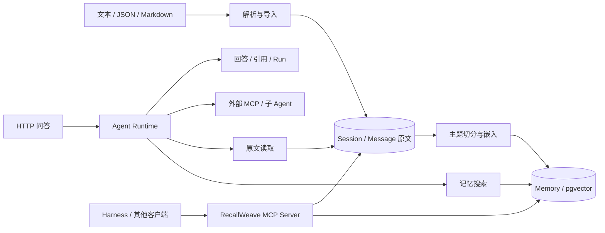

# 旁通 · Sidewise

旁通是一款从个人笔记出发的思考助手。把 Markdown 或 TXT 文件导入对话，选中一句至今还没想透的话，点 **从这段接着想**。Agent 会带着你的问题寻找其他记录，尝试提出一个新解释，并给出它读过的原文位置。你可以回到原文判断这个联系是否成立，也可以指出反例，让对话沿着另一条线索继续。

一次测试中，用户从读书会笔记里选了这样一个猜想：“那天大家终于聊起来，是因为我少讲了十分钟。”Agent 自己找到一篇换乘随记。估计走 7 分钟却走了 19 分钟时，记录者特意回去查了原因。另一次估计走 12 分钟，结果正好 12 分钟，记录者就径直去买书了。这给原问题带来了另一种解释：也许让读者开口的，是先猜了结局，又读到了出乎意料的一页。[查看这次实测](#跨笔记联想实测)

项目面向本地个人使用。PC 浏览器界面采用 React、TypeScript 和 Vite，Go 后端使用 Gin、GORM、PostgreSQL 和 pgvector，并提供 MCP 接口。**旁通（Sidewise）** 是作品名，源码仓库使用 **RecallWeave**，配置环境变量使用 `RECALLWEAVE_` 前缀。HTTP 服务默认监听 `127.0.0.1:8008`，远程部署需要在入口层配置访问控制。

## 阅读导航

- [已有能力](#已有能力)
- [快速启动](#快速启动)
- [打开浏览器对话界面](#打开浏览器对话界面)
- [导入 Markdown / TXT 并选段](#在对话里导入-markdown-和-txt)
- [跨笔记联想实测](#跨笔记联想实测)
- [试一次接着想](#试一次接着想)
- [完成一次导入与查询](#完成一次导入与查询)
- [配置与环境变量](#配置与环境变量)
- [HTTP API](#http-api)
- [Agent 与后台任务](#agent-与后台任务)
- [MCP 接入](#mcp-接入)
- [DeepSeek Harness 与二次开发](#deepseek-harness-与二次开发)
- [架构与源码入口](#架构与源码入口)
- [技术说明](#技术说明)
- [测试与验证](#测试与验证)
- [排障与已知边界](#排障与已知边界)

## 已有能力

| 能力 | 当前行为 |
| --- | --- |
| 导入资料 | 文本、ChatGPT 官方 JSON、Markdown 文档/聊天导出、ZIP 中选中的文本文件 |
| 原文保留 | Session 保存导入内容，Message 用会话内 Seq 排序，Memory 指向原文区间 |
| 记忆提炼 | 按批切分主题，区分事实、偏好、决定、任务和问题；支持增量提炼及降级 |
| 混合检索 | 关键词与 pgvector 余弦近邻两路召回，经活跃度重排和 RRF 融合后取 Top-K |
| 独立检索 | `GET /api/memories/search`，无聊天模型也可查关键词并取得原文位置 |
| 溯源问答 | 工具循环；引用只覆盖实际读取并与记忆区间相交的原始消息 |
| 接着想 | 从问题或旧笔记区间开始，按需核对过往原话、提出新联系、根据你的反馈继续 |
| 保存思考进度 | 每段对话保留一个你亲自写的停留点，可在本对话或新的普通对话中接续 |
| 生命周期 | 停用过时记忆，默认搜索排除 inactive；保留历史，限制整体重写 |
| 对话分支 | 从消息序号创建分支，保存继承快照并限制分支问答中的记忆可见范围 |
| 运行追踪 | 保存 Run、工具参数/结果、错误、模型用量、耗时与父子关系 |
| 子 Agent | researcher/reviewer、同步/后台委派、任务组、续接、取消和结果投递 |
| 后台通知 | SSE 持久化事件、游标续传与消息来源信息 |
| Skill 与产物 | 按需加载技能及参考文件；通过工具保存用户要求的文本产物 |
| 对外 MCP | stdio 与带 Bearer 鉴权的 Streamable HTTP，默认只读 |
| 外部工具 | 多个 HTTP MCP 服务、显式工具白名单、服务命名空间和独立令牌 |
| 增量写回 | stdio 显式开启 `-enable-import` 后，追加选定原始消息并支持安全重试 |

结构化引用表示“读取了这些原文”，不表示原文中的说法已获外部事实核验。当前没有可对外宣称的通用回答准确率或生产 SLA。

## 快速启动

### 依赖与启动

- Go **1.26.1 或兼容的新版本**，以 [go.mod](go.mod) 为准。
- PostgreSQL 与 pgvector；可用仓库的 [compose.yaml](compose.yaml) 启动数据库，也可使用已有实例。
- 可选：支持工具调用的 OpenAI 兼容聊天模型，以及兼容的嵌入模型。
- 浏览器对话界面使用 React 和 Vite，本轮在 Node.js 22.16.0 上验证。Go 后端可独立启动。

进入仓库根目录，执行以下 PowerShell 命令：

```powershell
# 仅首次创建配置；已有配置请保留并对照示例补齐字段。
if (-not (Test-Path config/config.yaml)) {
    Copy-Item config/config.example.yaml config/config.yaml
}
docker compose up -d --wait postgres
go mod download
go build ./cmd/...
go test ./cmd/... ./internal/... -count=1 -timeout 90s
go run ./cmd/server -config config/config.yaml
```

示例数据库为 `localhost:5434/recallweave`，用户 `postgres`、本地开发密码 `recallweave-local`。Compose 只绑定本机端口，数据保存在 named volume。已有配置中的数据库名、端口和密码必须与实例一致。

首次启动检查 pgvector 扩展，执行 GORM 建表/迁移并创建 HNSW 索引。账号需要对应权限；受限实例可由管理员预先执行 `CREATE EXTENSION IF NOT EXISTS vector`。安装方式见 [pgvector 官方说明](https://github.com/pgvector/pgvector#installation)。

另开终端检查：

```powershell
Invoke-RestMethod http://127.0.0.1:8008/healthz
```

返回 `{"status":"ok"}` 表示 HTTP 可响应；该接口不检查数据库和模型当前是否可用。

### 无模型与有模型两种模式

API key 留空也能启动：可以导入、按批保留原文生成兜底记忆，并使用关键词检索。问答接口返回 `503`。

完整 Agent 问答需要在**启动 Go 的同一终端**配置模型：

```powershell
$env:RECALLWEAVE_LLM_API_KEY = '<your-model-api-key>'
$env:RECALLWEAVE_LLM_BASE_URL = 'https://api.siliconflow.cn/v1'
$env:RECALLWEAVE_LLM_MODEL = '<your-tool-calling-chat-model>'
$env:RECALLWEAVE_EMBEDDING_MODEL = '<your-compatible-embedding-model>'
go run ./cmd/server -config config/config.yaml
```

按实际提供商替换模型名，示例中的名称不保证在所有账号/平台可用。聊天和嵌入目前共用 `llm.base_url` 与 `llm.api_key`；只用聊天时可将 `embedding_model` 留空。

当前支持入库 1536 维向量，或按现有策略截取前 1536 维并归一化的 4096 维输出。其他维度不会写入向量。切换嵌入模型前需核对维度和截断适用性；相同维度不代表不同模型向量可以混用。

Linux/macOS 可用 `cp` 创建配置，用 `export RECALLWEAVE_LLM_API_KEY='...'` 导出变量，其余 Go 与 Docker 命令相同。

## 打开浏览器对话界面

先按上节启动 Go 服务。导入和阅读笔记可以在无模型模式下使用，发送问题需要配置聊天模型。在仓库根目录另开终端运行以下命令。

```powershell
cd frontend/my-app
npm ci
npm run dev
```

打开 Vite 输出的本地地址，默认是 `http://127.0.0.1:5173`。前端将同源的 `/api` 请求代理至 `http://127.0.0.1:8008`。若后端监听其他地址，在启动 Vite 的终端设置 `RECALLWEAVE_API_TARGET`。模型密钥由 Go 服务读取。

- 输入框默认使用「接着想」，也可以切换到「普通对话」。提问建议会先填入输入框，编辑后按 Enter 发送，Shift + Enter 换行。
- 首次发送或首次导入笔记会创建对话。左侧显示服务返回的最近 20 条对话，可按标题筛选。刷新或重开带 `#chat/编号` 的地址会从后端读回原始消息。
- 即时回答可展开已核对的原文位置。刷新后，历史接口提供原始消息与用户选中的来源，逐条回答的即时引用仅在当前页面保留。
- 服务不可用时，输入框保留发送失败的文字。重试同一个问题前，页面会先核对这段对话是否已经写入回答。

在前端目录用 `npm run lint` 检查代码，用 `npm run build` 生成 `dist/`。使用独立静态服务托管构建结果时，将同域的 `/api` 转发到 Go 服务。

### 在对话里导入 Markdown 和 TXT

1. 打开目标对话，点输入框下方的 **导入笔记**，选择一个 UTF-8 编码的 `.md` 或 `.txt` 文件。单个文件最多 20 MiB。在新对话中先选文件，会以文件名创建对话。
2. 页面提示已保存后，点 **查看笔记**。列表显示这段对话中的文件名和记忆提炼状态。刷新浏览器后仍可打开。Markdown 按文档结构解析，普通 TXT 按空行分段。
3. 找到想继续讨论的原文，点 **从这段接着想**。输入框会显示文件名和段号。直接按 Enter 可从这段继续，也可以先写下自己的问题。原文保存后即可选取，跨笔记的记忆检索需要等待提炼完成。

## 试一次接着想

按上节启动带聊天模型的后端，在仓库根目录另开 PowerShell 5.1 或更新版本的终端。

```powershell
.\examples\think.ps1 -Question '为什么我记下了许多念头，后来却很少继续想？'
```

脚本会创建对话并打印对话 ID。直接输入下一句即可交谈。比如你觉得“因为缺少反馈”这个解释过于笼统，可以追一句“即便对方不回信，我写给朋友时也会想得更清楚”。看看下一轮的问题有没有因你的反例而改变。

| 终端输入 | 作用 |
| --- | --- |
| `/save 我想弄清楚，具体的听者如何改变我的表达` | 留下希望继续探索的方向 |
| `/reject 散步和写作的联系太牵强，我想先放下它` | 记下你否定哪条联系和理由 |
| `/reframe 如果对方永远不会回信，我还会写得更清楚吗？` | 用你重新表述的问题替换当前停留点 |
| `/continue` | 从已保存的停留点或本对话最近讨论接下去 |
| `/exit` | 退出客户端 |

每个对话只有一个当前停留点。三条保存命令都会替换它，成功后终端回显原文。重新打开原对话可以看到上次留下的话。在新对话中接续时只带入明确选定的停留点，原对话的完整历史仍归属原对话。以下编号请换成实际输出。

```powershell
.\examples\think.ps1 -ConversationId 12
.\examples\think.ps1 -ResumeFrom 12
```

### 从一段你选中的旧笔记出发

通过下节的导入接口保存自己的笔记，再从消息列表里选择原文区间。已有 Session 时也可以直接运行。

```powershell
# 将 9、2 换成实际的 session_id 和消息 seq
.\examples\think.ps1 -SessionId 9 -SeqStart 2 -Question '这和我以前在哪些场合更容易想清楚，有什么联系？'
```

可以只选原文，也可以加上自己的问题。省略 `-SeqEnd` 时取一条。直接选择依赖已保存的原文，跨主题检索则依赖历史资料已经提炼出可查的记忆。分支中可以选择继承快照、本分支消息，以及显式导入本分支的本地笔记。每次最多 50 条，所选范围必须完整可读。

**怎样理解回答。** `thinking.source` 是本次打开的笔记区间，`citations` 是工具实际核过的记忆原文。二者可分别查看。Agent 会据此尝试提出联系。评估时可以在空白演示库先问一次，导入两段自己的旧思考后再开新对话问同一个问题。对照两次回答，看哪条联系确实依赖那两段原话。再明确否定一次联想，观察下一轮是否转向你认可的方向。

**哪些东西会留下。** 聊天记录保留双方原文。提炼思考回合时，系统逐条保留用户实际输入的话，助手提出的假设留在聊天记录里。点击旧笔记或空问题续接产生的导航消息带有 `thinking_context.navigation` 标记，跳过长期记忆提炼。只有显式保存停留点才更新进度。用户可以在本地服务上无模型保存和读取进度，生成思考回应需要聊天模型。

### 从其他客户端调用

向 `POST /api/chat/:conversation_id` 发送以下任意一个 JSON 请求体。会话 ID 从创建对话的响应取得。

```json
{"mode":"thinking","question":"我在什么情况下会主动修正自己的想法？"}
```

```json
{"mode":"thinking","source":{"session_id":9,"seq_start":2,"seq_end":2}}
```

```json
{"mode":"thinking","resume_from":12}
```

可用 `POST /api/conversations/:id/thinking/checkpoint` 保存进度，例如 `{"text":"下次我想追问，谁在听真的重要吗？","direction":"reframe"}`。同路径 GET 返回 `{"checkpoint": ...}`，已有对话尚未保存时值为 `null`。文本最多 2000 个字符。方向可省略，也可选 `explore`、`reject`、`reframe`。跨对话接续要求来源和目标都是普通对话。分支可以在自身内部接续。

显式思考请求由服务加载 [thinking-partner 技能](skills/thinking-partner/SKILL.md)，模型根据中间结果选择检索、读原文或直接回答。思考模式只开放当前范围的记忆读取业务工具。响应中的 `run_id` 可以在 `GET /api/runs/:run_id` 查看每一步和该次使用的起点。未设 `mode` 的请求沿用原有聊天接口。

前台 Go 进程用 `Ctrl+C` 退出，会尝试停止 worker 并关闭 HTTP。`docker compose stop` 停止数据库并保留数据；`docker compose down` 也保留 named volume，添加 `-v` 则会删除数据库数据。

## 完成一次导入与查询

下面的导入和关键词检索不需要模型 key。在服务启动后执行：

```powershell
$base = 'http://127.0.0.1:8008'
$body = @{
    source_tag = 'codex'
    name = '数据库选型'
    format = 'markdown'
    text = "# 项目决定`n`n项目使用 PostgreSQL 保存消息，使用 pgvector 检索记忆。"
} | ConvertTo-Json
$import = Invoke-RestMethod -Method Post -Uri "$base/api/imports" `
    -ContentType 'application/json; charset=utf-8' -Body ([Text.Encoding]::UTF8.GetBytes($body))
$sessionId = $import.sessions[0].session_id
Invoke-RestMethod "$base/api/sessions/$sessionId"
```

HTTP 导入先保存资料，再异步提炼；`201` 与 `extract_status: pending` 表示已受理，**不表示提炼已经完成**。稍后查询 Session 的 `extract_status`：`pending`、`done`、`failed` 或 `skipped`。查看 `extract_error` 排查失败。

状态完成后检索并查看原文：

```powershell
$keyword = [Uri]::EscapeDataString('PostgreSQL')
$hits = Invoke-RestMethod "$base/api/memories/search?q=$keyword&limit=5"
$hits.memories
Invoke-RestMethod "$base/api/sessions/$sessionId/messages"
Invoke-RestMethod "$base/api/sessions/$sessionId/memories"
```

结果的 `session_id`、`seq_start`、`seq_end` 定位原始消息。此检索接口不增加记忆召回计数。

启用聊天模型后，创建对话并提问：

```powershell
$conversation = Invoke-RestMethod -Method Post -Uri "$base/api/conversations/create" `
    -ContentType 'application/json' -Body '{"title":"RecallWeave demo"}'
$conversationId = $conversation.id
$question = @{ question = '我之前决定使用什么数据库？请核对原文并说明依据。' } | ConvertTo-Json
$answer = Invoke-RestMethod -Method Post -Uri "$base/api/chat/$conversationId" `
    -ContentType 'application/json; charset=utf-8' -Body ([Text.Encoding]::UTF8.GetBytes($question))
$answer
Invoke-RestMethod "$base/api/runs/$($answer.run_id)"
```

回答包含 `answer`、`citations`、`rounds`、`run_id`、`usage`、`timings`。引用是否存在取决于这次运行是否真正查到并核对原文；普通知识问答允许不查历史。

文件上传使用 multipart：

```powershell
# 使用 curl.exe，避免 PowerShell 中同名别名的差异。
curl.exe -X POST http://127.0.0.1:8008/api/imports/file -F source_tag=codex -F format=markdown -F "file=@notes.md"
curl.exe -X POST http://127.0.0.1:8008/api/imports/file -F source_tag=chatgpt -F "file=@conversations.json"
```

要在 PC 界面的「查看笔记」中看到自己的文件，请指定已创建的对话、`local_note` 来源和文件名。以下示例使用对话 3。

```powershell
curl.exe -F "source_tag=local_note" -F "name=notes.md" -F "file=@notes.md" http://127.0.0.1:8008/api/conversations/3/imports/file
curl.exe -F "source_tag=local_note" -F "name=ideas.txt" -F "file=@ideas.txt" http://127.0.0.1:8008/api/conversations/3/imports/file
```

省略 `format` 可按文件名识别 Markdown，也可以显式传 `markdown`。Markdown 支持普通文档以及成对 User/Assistant 标题的聊天导出。ZIP 优先选 `conversations.json`，否则只读取首个可识别文本条目，不批量导入整个压缩包。

来源标签包括本地笔记的 `local_note`，以及 `wx`、`qq`、`weibo`、`twitter`、`facebook`、`instagram`、`youtube`、`tiktok`、`cursor_ide`、`cursor_agent`、`codex`、`chatgpt`、`deepseek_harness`。标签记录资料出处。ChatGPT 官方 JSON 有专用解析，其余平台的文本导出走通用解析。`chat` 保留给内部聊天。

## 配置与环境变量

完整示例见 [config/config.example.yaml](config/config.example.yaml)。优先级：内置默认值 → YAML → 进程环境变量；显式空字符串也会覆盖 YAML，可用来关闭 key 或嵌入模型。

两个入口均支持 `-config`。未传时读取 `RECALLWEAVE_CONFIG`，再退回 `config/config.yaml`。相对路径以进程工作目录解析，从其他目录启动时建议传配置绝对路径并设置工作目录。

| 配置 | 环境变量 | 默认或说明 |
| --- | --- | --- |
| 配置文件 | `RECALLWEAVE_CONFIG` | `config/config.yaml`，命令行 `-config` 优先 |
| `server.host` | `RECALLWEAVE_HOST` | `127.0.0.1` |
| `server.port` | `RECALLWEAVE_PORT` | `8008`，范围 1–65535 |
| `database.host` | `RECALLWEAVE_DB_HOST` | `localhost` |
| `database.port` | `RECALLWEAVE_DB_PORT` | `5434` |
| `database.user_name` | `RECALLWEAVE_DB_USER` | `postgres` |
| `database.password` | `RECALLWEAVE_DB_PASSWORD` | Go 内置为空，示例/Compose 为本地开发密码 |
| `database.db_name` | `RECALLWEAVE_DB_NAME` | `recallweave` |
| `llm.base_url` | `RECALLWEAVE_LLM_BASE_URL` | OpenAI 兼容接口基址 |
| `llm.api_key` | `RECALLWEAVE_LLM_API_KEY` | 空则关闭聊天模型 |
| `llm.model` | `RECALLWEAVE_LLM_MODEL` | 聊天和提炼模型 |
| `llm.embedding_model` | `RECALLWEAVE_EMBEDDING_MODEL` | 空则不生成可用嵌入 |
| `llm.timeout_seconds` | `RECALLWEAVE_LLM_TIMEOUT_SECONDS` | 默认 30，0 使用客户端默认值，最大 3600 |
| `skills.dir` | `RECALLWEAVE_SKILLS_DIR` | `skills` |
| `artifacts.dir` | `RECALLWEAVE_ARTIFACTS_DIR` | `data/artifacts` |
| HTTP MCP Bearer | `RECALLWEAVE_MCP_TOKEN` | 空则不注册 `/mcp` |
| 外部 MCP Bearer | 各条目的 `token_env` 指定 | 以 Authorization Bearer 发送 |

Go **不自动加载 `.env`**。Compose 读取 `.env` 替换自身变量；直接运行 Go 时需在进程中导出对应值，或写入被忽略的本机 YAML。不要将真实凭据写入示例文件。

## HTTP API

ID 应从实际响应取得，不要假定首次创建一定是 `1`。错误通常返回 `{"error":"..."}`。

| 方法 | 路径 | 用途 / 主要输入 |
| --- | --- | --- |
| GET | `/healthz` | HTTP 存活 |
| POST | `/api/imports` | JSON：`source_tag`、`text`，可选 `name`、`format` |
| POST | `/api/imports/file` | multipart：`source_tag`、`file`，可选 `name`、`format` |
| POST | `/api/conversations/:conversation_id/imports` | 资料导入并绑定现有对话 |
| POST | `/api/conversations/:conversation_id/imports/file` | 文件导入并绑定现有对话 |
| GET | `/api/conversations/:conversation_id/notes` | 当前对话的本地笔记，返回文件名、Session ID、提炼状态 |
| GET | `/api/sessions/:session_id` | 数量、状态和提炼错误 |
| GET | `/api/sessions/:session_id/messages` | 原始消息与后台投递来源 |
| GET | `/api/sessions/:session_id/memories` | 会话记忆，包含停用记录 |
| POST | `/api/sessions/:session_id/extract` | 整体提炼，受停用历史和分支保护限制 |
| GET | `/api/memories/search` | 全库记忆只读检索，参数见下表 |
| POST | `/api/conversations/create` | JSON：可选 `title` |
| GET | `/api/conversations/list` | 最近对话，当前默认最多 20 条 |
| GET | `/api/conversations/list/with_title` | 最近对话及标题 |
| GET | `/api/conversations/:conversation_id/messages` | 本对话消息与继承消息快照 |
| POST | `/api/conversations/:conversation_id/fork` | JSON：`from_seq`、可选 `title` |
| POST | `/api/chat/:conversation_id` | 普通问答或 `mode=thinking`，可选 `source`、`resume_from` |
| GET / POST | `/api/conversations/:conversation_id/thinking/checkpoint` | 读取或替换用户亲自填写的思考停留点 |
| GET | `/api/runs/:run_id` | 运行状态、工具步骤、用量和耗时 |
| GET | `/api/conversations/:conversation_id/runs` | 对话运行列表 |
| GET | `/api/conversations/:conversation_id/subagent-tasks` | 后台任务列表 |
| GET | `/api/conversations/:conversation_id/subagent-tasks/:task_id` | 任务详情 |
| POST | `/api/conversations/:conversation_id/subagent-tasks/:task_id/cancel` | 取消任务 |
| GET | `/api/conversations/:conversation_id/task-groups` | 任务组列表 |
| GET | `/api/conversations/:conversation_id/task-groups/:group_id` | 任务组详情 |
| POST | `/api/conversations/:conversation_id/task-groups/:group_id/cancel` | 取消任务组 |
| GET | `/api/conversations/:conversation_id/events` | SSE 后台事件流 |
| MCP | `/mcp` | 配置令牌后开启的只读 Streamable HTTP 端点 |

### 独立记忆检索

| 参数 | 约束 |
| --- | --- |
| `q` | 必填，去空白后 1–4096 UTF-8 字节 |
| `limit` | 默认 5，范围 1–20 |
| `tag` | 可选：work / study / tech / product / decision / people / life / other |
| `include_inactive` | true / false，默认 false，回顾历史时开启 |

返回 `{"memories":[...]}`，空结果为 `[]`。字段包含 `id`、`session_id`、`seq_start`、`seq_end`、`title`、`content`、`tag`、`content_type`、`status`；不返回向量。这是本地资料库入口，不代表项目或租户权限隔离。

### SSE 与状态码

```powershell
# 将 1 替换为实际对话 ID。
curl.exe -N "http://127.0.0.1:8008/api/conversations/1/events?after=0"
```

事件帧包含 `id`、`event`、`data`。重连可用 `Last-Event-ID` 请求头或 `after` 参数，请求头优先；游标必须属于该对话。SSE 用于后台任务、消息和报告通知；普通聊天当前仍返回完整 JSON，尚无逐 token 回答流。

成功导入返回 `201`。常见客户端错误有 `400`（参数不合法）、`401`（MCP 令牌不匹配）、`404`（资源不存在或 MCP 未启用）、`409`（历史或分支保护冲突）和 `413`（上传的文件超过 20 MiB）。聊天接口用 `402` 表示模型服务商要求付费，用 `503` 表示模型或对应能力不可用。内部失败返回 `500`。

## Agent 与后台任务

主 Agent 默认最多 6 轮。业务工具提供记忆搜索、原文读取、会话查看和记忆停用；运行时另提供计划、委派与后台任务操作。Skill 提供任务说明，Ability 提供业务工具，二者分开装配。

默认 `researcher` 检索核对，`reviewer` 检查给定结论与来源。子 Agent 的工具是**角色白名单与父 Agent 实际工具集的交集**，不会自动获得所有新接入工具。默认角色兼容旧 Tavily 工具名及 `name: tavily` 的新命名空间。

自定义角色参见配置示例的 `subagents.PresetAgents`，字段区分大小写。轮数最大 20，超时最大 300 秒，0 表示继承默认预算。其他服务名的工具需加入角色白名单。当前后台配置为 2 个 worker、队列容量 8。

用户可以要求“后台研究……，完成后通知我”，由模型选择相应委派工具。任务 ID 从运行结果或任务列表取得，用详情、取消和 SSE 接口观察结果。工具选择由模型决定，提示词不是强制执行保证。后台结果/报告保存实际来源及可查询的投递状态。

## MCP 接入

### 外部 Agent 读取 RecallWeave

| 工具 | 输入与限制 |
| --- | --- |
| `search_memories` | keyword，可选 tag、limit、include_inactive；默认 5、最多 20 条 |
| `get_messages` | session_id、seq_start、seq_end；闭区间，每次最多 50 条 |
| `import_transcript` | 仅 stdio 显式开启 `-enable-import` 后提供 |

本地 stdio 由 MCP 客户端作为子进程启动：

```powershell
go build -o bin/recallweave-mcp.exe ./cmd/mcp
.\bin\recallweave-mcp.exe -config config/config.yaml
```

协议走 stdin/stdout，日志走 stderr。首次需先启动一次 `cmd/server` 完成数据库迁移。`cmd/mcp` 不启动 HTTP 服务，也不为 HTTP `/mcp` 添加写入工具。

HTTP 模式：

```powershell
$env:RECALLWEAVE_MCP_TOKEN = '<a-long-random-token>'
go run ./cmd/server
# 另一个终端设置同样的令牌，然后列出工具：
go run ./cmd/mcp-probe -url http://127.0.0.1:8008/mcp -token-env RECALLWEAVE_MCP_TOKEN
```

未配置令牌时 `/mcp` 不注册；启用后所有协议请求都需正确 Bearer。该令牌**只保护 MCP 路径**。直接浏览器 GET 不是连接测试：无状态端点通过鉴权后对 GET 返回 405。探针只发现工具，不调用模型或具体工具。

### RecallWeave 调用多个外部 MCP

```yaml
external_mcps:
  - name: tavily
    url: https://mcp.tavily.com/mcp/
    token_env: TAVILY_API_KEY
    tools: [tavily_search, tavily_extract]
  - name: docs
    url: http://127.0.0.1:8090/mcp
    tools: [search]
```

启动前导出 `$env:TAVILY_API_KEY = '<your-token>'`。`token_env` 填变量名，实际值以 `Authorization: Bearer ...` 发送，不作为自定义 HTTP 头名。

- 服务名唯一，匹配 `[A-Za-z0-9_-]{1,32}`；工具必须显式列入白名单。
- 模型名称为 `mcp__<service>__<raw_tool>`，同名工具按服务隔离，远端调用仍用原始名称。
- 原始工具名支持字母、数字、下划线、短横线，最长 60；完整名称最长 64，超长明确拒绝。
- URL 仅接受 HTTP(S)，不允许用户密码、query 或 fragment；凭据从环境读取。
- 每服务启动预算 20 秒，HTTP 请求超时 15 秒；不跟随重定向。
- 任一连接或白名单失败，中止启动并关闭已连接会话；不会静默启用部分工具。
- 当前启动时发现工具，未实现热更新、自动重连、出站 stdio、OAuth 或 resources/prompts。

旧 `external_mcp` 继续兼容，工具名仍为 `mcp_<raw_tool>`；它与非空 `external_mcps` 互斥。迁移时同步修改自定义子角色引用的工具名。

## DeepSeek Harness 与二次开发

[DeepSeek Harness](https://github.com/deepseek-ai/deepseek-harness) 提供插件化 Agent 工作台，其 MCP client 支持 stdio 与 HTTP。这里建议由 Harness 承担交互/工具工作台，RecallWeave 保留长期记忆和原文权威，通过 MCP 连接，再按需开发插件或界面。这是基于当前代码边界的工程选择；官方仍提示预览阶段可能有不兼容变更。

本仓库提供接入配置，**没有 fork 或替换为 Harness 运行时**：

- [本地 stdio overlay](examples/deepseek-harness/recallweave.stdio.patch.yml)
- [HTTP overlay](examples/deepseek-harness/recallweave.http.patch.yml)
- [详细接入、验收与二次开发路径](docs/deepseek-harness.md)

修改 stdio 示例中的绝对路径，两种 overlay 选一种，使用支持该配置的 Harness 版本启动：

```powershell
npx @deepseek-ai/dsh --profile web --patch 'C:/path/to/RecallWeave/examples/deepseek-harness/recallweave.stdio.patch.yml'
```

预期发现 `mcp__recallweave__search_memories` 和 `mcp__recallweave__get_messages`。示例依据 [官方 MCP client 配置](https://github.com/deepseek-ai/deepseek-harness/blob/master/packages/mcp/mcp-client/README.md) 与 [CLI 配置层说明](https://github.com/deepseek-ai/deepseek-harness/blob/master/apps/cli/README.md) 编写，不代表已完成 Harness 实机端到端验收。

可选写回：stdio 参数加 `-enable-import` 后，外部 Agent 才能调用 `import_transcript`。仅在当前用户明确要求保存时传选定的原始消息；每次最多 50 条 user/assistant 消息、合计 64 KiB 文本。稳定 `external_session_id` 和 `seq_start` 支持增量追加；重叠内容须逐字一致，不允许跳号。省略外部 ID 每次新建 Session，不具备批次去重。Harness 日常对话不会自动写成 RecallWeave 记忆。

## 架构与源码入口

### 技术说明

1. **保存原文。** 导入器把笔记保存为一个 Session。Markdown 按文档结构解析，TXT 按空行分段，每段原文都有会话内的消息序号 `seq`。后台按批提炼记忆，每条记忆携带 `session_id`、`seq_start` 和 `seq_end`，因此即使多条笔记都讨论同一件事，也能回到各自的原话。[解析与导入](internal/ingest/ingest.go)
2. **跨笔记找线索。** 用户选段后，后端把该段原文和提问一起交给模型。Agent 可以调用 `search_memories` 找候选记忆。关键词检索适合人名、短语等明确线索。配置可用的嵌入模型时，系统还可通过 pgvector 的余弦近邻检索找到措辞不同的相关内容，再用倒数排名融合（RRF）合并两路结果。[思考上下文](internal/chat/thinking.go) · [记忆检索](internal/memory)
3. **读取并核对。** Agent 可以调用 `get_messages` 读回候选记忆对应的原文，再决定继续搜索还是作答。后端将检索命中的区间与工具成功读到的段落取交集，据此生成 `citations`。用户主动选中的起点由 `thinking.source` 单独记录。一次问答的工具调用、结果和错误可通过 `run_id` 回看。[工具循环](internal/agent/runtime/runtime.go) · [引用生成](internal/chat/citation.go)



- `Session` 是消息容器；`Message.ID` 是行 ID，`Message.Seq` 是会话内序号。
- `Conversation` 是与助手交互的对话，可关联聊天 Session、导入资料和分支快照。
- `Memory` 是带类型、状态与原文区间的提炼结果，不替代原文。
- `AgentRun` 是一次执行，同一对话可以产生多个 Run，子 Agent 也有运行记录。
- 模型上下文由最近消息、简报、预载和工具结果组成，不等于整个数据库。

| 位置 | 职责 |
| --- | --- |
| [cmd/server](cmd/server) | 配置、依赖装配、HTTP 与后台任务生命周期 |
| [cmd/mcp](cmd/mcp) / [cmd/mcp-probe](cmd/mcp-probe) | stdio 服务 / HTTP MCP 探针 |
| [internal/http](internal/http) | 路由、校验、状态码、SSE 与鉴权 |
| [internal/parser](internal/parser) / [internal/ingest](internal/ingest) | 解析、保存、外部会话同步 |
| [internal/extract](internal/extract) | 批处理提炼、降级、增量覆盖与并发提交 |
| [internal/memory](internal/memory) / [internal/retrieval](internal/retrieval) | 生命周期、融合、活跃度和向量近邻 |
| [internal/agent](internal/agent) | Agent、Ability、技能与外部工具 |
| [internal/agent/runtime](internal/agent/runtime) | 工具循环、计划、运行状态和来源 |
| [internal/agent/subagent](internal/agent/subagent) | 角色权限、委派、任务组和 worker |
| [internal/chat](internal/chat) | 上下文、保存回合、引用、结果与报告投递 |
| [internal/mcp](internal/mcp) | 记忆工具、远端客户端、工具适配和连接组 |
| [internal/llm](internal/llm) | 模型协议、工具调用和上下文快照 |
| [internal/conversation](internal/conversation) / [internal/session](internal/session) | 对话、消息、分支与投递来源 |
| [internal/config](internal/config) / [internal/db](internal/db) / [internal/types](internal/types) | 配置、数据库初始化和持久化模型 |
| [skills](skills) | thinking-partner、memory-audit、topic-review、web-research |
| [internal/eval](internal/eval) | 固定样例验证，非公开基准成绩 |

问答阅读路线：`cmd/server/main.go → internal/http/chat.go → internal/chat/chat.go → internal/agent/runtime/runtime.go`；随后看 parser/ingest/extract 的导入链路。

## 测试与验证

```powershell
go test ./cmd/... ./internal/... -count=1 -timeout 90s
go vet ./cmd/... ./internal/...
go build ./cmd/...
```

普通测试用内存 MCP、SQLmock 和本机 HTTP 模拟模型，不调用真实收费模型。测试需允许访问本机端口。限定 Go 包路径可避免扫描前端的 Node 依赖。

数据库测试需 `integration` tag，并明确创建专用数据库：

```powershell
$env:RECALLWEAVE_WORKFLOW_DATABASE_URL = 'postgres://postgres:<password>@127.0.0.1:5434/recallweave_workflow_test?sslmode=disable'
$env:RECALLWEAVE_TEST_DATABASE_URL = 'postgres://postgres:<password>@127.0.0.1:5434/recallweave_extract_test?sslmode=disable'
$env:RECALLWEAVE_TRANSCRIPT_DATABASE_URL = 'postgres://postgres:<password>@127.0.0.1:5434/recallweave_transcript_test?sslmode=disable'
go test -tags integration ./internal/http ./internal/extract ./internal/ingest -count=1 -timeout 120s
```

使用测试实例，先创建 URL 对应的三个数据库。测试会创建随机 schema 并在结束时清理，账号需对应权限；特殊字符密码需 URL 编码。未设置变量时会 skip，不能当作数据库验收通过。

覆盖 HTTP 问答和原文引用、无模型提炼/搜索、停用过滤、提炼并发保护、MCP transcript 去重/冲突/追加。真实模型验收需另设 `RECALLWEAVE_LIVE_MODEL=1` 和 `RECALLWEAVE_LIVE_CONFIG_PATH`，按对应测试代码运行，可能产生模型费用。

### 验证「接着想」

配置好上面的专用工作流测试库后，运行下面的两条 PostgreSQL 验收用例。

```powershell
go test -tags integration ./internal/http -run 'TestPostgres(ThinkingPartnerWorkflow|HTTPThinkingCheckpoint)$' -count=1 -v
```

第一条场景经 HTTP 导入两段 Markdown 讨论，从一段写作原文出发去核对一段音乐练习的原话。它检查引用范围、说话人、写入长期记忆的内容，以及保存进度后重新组装服务、跨对话接续时能否还原起点。第二条检查停留点的替换、隔离和重新连接数据库后的读回。场景使用确定性模型与真实 PostgreSQL。个人是否觉得某个联想有启发，需要用自己的笔记和配置的聊天模型判断。

2026-11-23 还用编译出的 Go 服务、独立 PostgreSQL 18 / pgvector 测试库和本机模拟模型实跑了 PowerShell 客户端。中文提问并用 `/save` 保存后，停止并重新启动 Go 进程，再用 `-ConversationId` 和 `-ResumeFrom` 接回同一问题。HTTP 读回了两次完成的 Run 和四条消息，恢复操作带有导航标记。

### 跨笔记联想实测

2026-11-26，使用桌面 Chromium 和配置的 `deepseek-ai/DeepSeek-V4.1-Flash` 实测。测试对话里有两份示例笔记：《周三读书会》（Markdown，2 段）和《换乘随记》（TXT，3 段）。用户只选了读书会第 1 段，提问中没有出现“换乘”或“车票”。

> 我猜那天大家聊起来，是因为我少讲了十分钟。翻翻我别的记录，有没有一件看似无关的事，会让你对这个解释产生怀疑？请拿原话说说，最后帮我想一个下次读书会就能试的小改动。

<details>
<summary>展开两份示例原文，复现这次提问</summary>

分别将下面两段内容保存为 UTF-8 文件，在同一段新对话中导入。等两份笔记都显示「已提炼」，打开第一份，在「散场后的猜想」点「从这段接着想」，发送上面的问题。

**01-周三读书会.md**

```markdown
# 周三读书会

## 散场后的猜想

我猜，那天大家终于聊起来，是因为我少讲了十分钟。以前我会把短篇从头介绍到尾，再问一句“大家怎么看”，最后常常还是我自己接话。

## 那天的经过

这次读到倒数第二页我就停了，请每个人在折好的纸角写下：主角会不会把那封信寄出去？不用署名，也不用交给我。翻过最后一页，小孟自己摊开纸，说：“我写的是会。可他连邮票都买了，怎么反而把信放回抽屉？”后面十几分钟几乎都是他们在聊。我挺想知道，下次只把开场缩短，会不会也这样。
```

**02-换乘随记.txt**

```text
这阵子每周四都去同一家旧书店。换乘通道很长，我通常一路走一路听播客。上周耳机没电，我在背包里翻出一张蓝色车票，在背面写了“从下车到走出南口，7分钟”，看一眼表才开始走。

走出南口一算，整整19分钟。我第一次想弄清楚那12分钟丢在哪里。回程特意又走了一遍，才发现自己一直跟着“换乘大厅”的人流绕远，楼梯侧面还有一块很小的南口指示牌。

今天坐同一班车，耳机也没戴。我又在票背写了一个数，这次估12分钟，出来正好12分钟。我把票塞回口袋就去买书了，连沿路的指示牌都没再看。
```

</details>

| 核对项 | 本次结果 |
| --- | --- |
| Agent 实际做了什么 | 经过 4 轮模型调用，主动检索了 2 次记忆，随后用 `get_messages` 分别读取两份笔记。 |
| 引用能否回到原文 | 回答附带两个引用区间，分别指向读书会第 1–2 段和换乘随记第 1–3 段。 |
| 联想是否站得住 | 回答找到了读书会里“先写下对结局的判断”这个细节。换乘的两次经历里都写了预测，只有猜错的那次回头追查，因此还值得追问：猜错结局的读者，是否比猜对的人更想发问？ |

要用自己的资料做同样的检验，可以选两份主题不同的笔记，只点选第一份的原文，让 Agent 自己寻找另一种解释。回答后展开「已核对的原文」，看第二份里的哪处细节支持这个解释，又有哪处细节会让它站不住。

### 基础服务验证记录（2026-11-19）

- 完整后端普通测试、`go vet` 与入口构建通过。
- 独立 PostgreSQL 18 / pgvector 临时容器中的 HTTP、提炼和 transcript 集成测试通过；模型由测试实现模拟。
- 实际 HTTP 二进制使用示例配置完成初始化、无模型导入、关键词检索、原文读取、503 降级与 MCP 鉴权验证。
- 实际 stdio 子进程完成显式写回、本地兜底提炼、关闭重启、只读工具发现与原文读回。
- Compose 配置静态校验通过；提供的 PostgreSQL 16 Compose 镜像组合本轮未实际启动。未调用真实模型，未进行 Harness 本体的端到端验收。

## 排障与已知边界

| 现象 | 检查 |
| --- | --- |
| 配置读不到 | 工作目录、`-config`、`RECALLWEAVE_CONFIG` |
| 数据库连不上 | 容器健康、端口、库名和进程环境；Compose `.env` 不自动传给 Go |
| vector 类型/扩展错误 | 安装 pgvector，由有权限账号启用扩展 |
| 旧向量列宽度不兼容 | 备份后按报错要求重新嵌入；迁移不静默改写旧向量 |
| 问答 503 | 模型 key 是否进入启动进程，是否被空环境变量覆盖 |
| 问答 402 | 模型服务商拒绝了本次计费请求。核对后端 API Key 所属账户的可用余额和模型计费要求，处理后可在原对话重试。 |
| 能打开聊天页，但「查看笔记」返回 404 | 若聊天记录可读而笔记路由不存在，在仓库根目录用 `go run ./cmd/server` 重启更新后的后端，确认前端代理指向该实例。 |
| 导入后无结果 | 先查 Session 提炼状态，再核对关键词、标签与 inactive |
| 无嵌入模型仅关键词 | 支持的降级路径，空向量存为 SQL NULL |
| 外部 MCP 启动失败 | 变量名/值、最终端点、白名单工具是否实际存在 |
| 两种外部配置冲突 | 单服务与非空多服务配置只能选一种 |
| 子角色看不到工具 | 完整工具名需同时存在于角色白名单和父 Agent |
| MCP 404 / 401 / 405 | 未启用 / 令牌错误 / GET 不支持；用探针验证 |
| 重提炼 409 | 停用历史或私有分支受保护，不可整体重写绕过 |
| SSE 没有回答文本 | SSE 为后台通知，普通聊天读取 POST 的 JSON 响应 |

其他边界：来源标签不等于平台解析器；Markdown 成对 User/Assistant 标题可能误判普通文档；ZIP 不批量展开；现有上传读取不适合超大文件；HTTP 普通导入通常新建 Session，增量幂等语义专属于带外部 ID 的 transcript 同步；后台导入提炼在进程退出期间仍可能中断，需观察状态并重试。

尚无独立项目命名空间、多用户权限系统、可配置 reranker 或完整管理界面。分支问答可见性规则不代表租户隔离。MCP 连接组也不包含 Harness 的热加载、插件沙箱或桌面工作台能力。源码与测试是行为依据，后续方向和接入示例不等于已交付产品能力。
