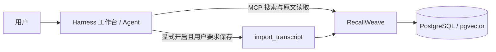

# DeepSeek Harness 接入与二次开发

本文配合 [主 README](../README.md)，介绍如何把 RecallWeave 作为记忆服务接入 Harness，以及后续二次开发的边界。

本文依据 2026-11-19 查阅的上游 [MCP client 文档](https://github.com/deepseek-ai/deepseek-harness/blob/master/packages/mcp/mcp-client/README.md)、[CLI 文档](https://github.com/deepseek-ai/deepseek-harness/blob/master/apps/cli/README.md) 与 [架构文档](https://github.com/deepseek-ai/deepseek-harness/blob/master/docs/architecture.md)。上游处于预览阶段，接入前请核对实际安装版本。

## 关系与当前交付



RecallWeave 已有自己的 Agent、后台委派和记忆生命周期。使用 Harness 时可以让 Harness 调用只读记忆工具，不必再由 RecallWeave 的主 Agent 转发同一问题。

当前交付的是两份可修改使用的 overlay、受鉴权保护的 HTTP 端点，以及多外部服务工具接入能力。没有 fork 上游、没有移植其 UI，也没有把本项目运行时换成 Cordis。MCP 层有本地模拟和数据库验收；Harness 本体尚未进行实机端到端验证。

## 方案一：本机 stdio

适合 Harness 与数据库运行在同一台机器的情况。

1. 按主 README 准备数据库和本机配置，先启动一次 HTTP server 完成迁移。
2. 在 RecallWeave 根目录构建：

```powershell
go build -o bin/recallweave-mcp.exe ./cmd/mcp
```

3. 修改 [recallweave.stdio.patch.yml](../examples/deepseek-harness/recallweave.stdio.patch.yml) 的 `command`、`args` 中配置路径和 `cwd`，全部使用实际绝对路径。Linux/macOS 构建时可去掉 `.exe`。
4. 启动支持这些配置字段的 Harness 版本：

```powershell
npx @deepseek-ai/dsh --profile web --patch 'C:/path/to/RecallWeave/examples/deepseek-harness/recallweave.stdio.patch.yml'
```

模型与工作目录在 Harness 中配置。预期工具名是 `mcp__recallweave__search_memories` 和 `mcp__recallweave__get_messages`。这里的前缀由 Harness 分配，RecallWeave 在线路上仍暴露原始工具名。

Harness 的 stdio 子进程环境可能经过清理。只靠数据库 YAML 和关键词检索时无需传模型 key；如果需要通过环境变量覆盖数据库或启用嵌入，应在 overlay 的 `config.env` 中显式传入必要变量，例如：

```yaml
    env:
      RECALLWEAVE_LLM_API_KEY: !!js process.env.RECALLWEAVE_LLM_API_KEY
```

仅在父进程中确实设置该变量时添加此配置，其他覆盖变量同理。不要将实际 key 写入可提交的 overlay，也不要通过命令行参数传递 key。

## 方案二：Streamable HTTP

适合独立运行 RecallWeave 服务、由 Harness 连接的情况。先在 RecallWeave 终端设置：

```powershell
$env:RECALLWEAVE_MCP_TOKEN = '<a-long-random-token>'
go run ./cmd/server -config config/config.yaml
```

在启动 Harness 的终端设置**相同令牌**，选择 [recallweave.http.patch.yml](../examples/deepseek-harness/recallweave.http.patch.yml)：

```powershell
$env:RECALLWEAVE_MCP_TOKEN = '<the-same-token>'
npx @deepseek-ai/dsh --profile web --patch 'C:/path/to/RecallWeave/examples/deepseek-harness/recallweave.http.patch.yml'
```

此处用 Harness 支持的 YAML 表达式构造请求头。HTTP 端点仅提供只读工具。没有配置服务端令牌时 `/mcp` 为 404；令牌错误为 401。正确 Bearer 下直接 GET 为 405，这是当前无状态实现的行为。

远程部署时，还需配置服务监听地址、HTTPS 与普通 API 的入口访问控制。仅设置 `RECALLWEAVE_MCP_TOKEN` 不会保护 `/api/*`。示例默认连接本机，不会自动开放远端访问。

## 最小验收

先通过 RecallWeave HTTP API 导入一份明确包含某项决定的资料，等待 Session 的 `extract_status` 变为 `done`，记录返回的 Session ID。

在 Harness 中执行这些检查：

| 检查 | 通过条件 |
| --- | --- |
| 工具发现 | 列出 search_memories、get_messages；默认没有 import_transcript |
| 查询 | 用资料中的明确关键词检索，命中包含 Session ID 与 Seq 区间 |
| 原文回查 | 按命中区间调用 get_messages，内容与导入原文一致 |
| 回答 | 结论区分原文陈述与推断，不把历史助手回答视为独立事实证据 |
| HTTP 拒绝测试 | 无令牌和错误令牌无法读取记忆 |
| 重启 | 关闭并重启客户端后，仍能查到数据库中保存的资料 |

HTTP 模式也可以先用探针检查工具发现：

```powershell
go run ./cmd/mcp-probe -url http://127.0.0.1:8008/mcp -token-env RECALLWEAVE_MCP_TOKEN
```

探针成功只证明协议初始化和工具发现成功，不证明模型会正确使用工具。

## 可选：保存选定消息

只在 stdio overlay 的 `args` 添加 `-enable-import` 后，才提供 `import_transcript`。使用前必须由当前用户明确要求保存选定消息，发送原始角色和文本。

示例调用参数：

```json
{
  "source_tag": "deepseek_harness",
  "name": "项目选型记录",
  "external_session_id": "your-stable-harness-session-id",
  "seq_start": 1,
  "messages": [
    {"role": "user", "content": "这次项目使用 PostgreSQL。"},
    {"role": "assistant", "content": "已确认使用 PostgreSQL。"}
  ]
}
```

增量规则：来源标签和外部会话 ID 组成稳定身份；后续消息可从下一序号追加，也可重传完全一致的旧区间。冲突内容和跳号会被拒绝；编辑过的会话应使用新身份。省略外部 ID 每次新建独立 Session。单次最多 50 条消息、合计 64 KiB 文本。

导入工具保存原文，即使提炼失败或被跳过也会返回对应状态，应检查 `extract_status`。未配置模型时使用本地兜底提炼，仍可按关键词查找选定消息。这不是全会话自动同步器。不要将 Harness 原始 JSONL 日志直接交给普通文本导入并期待它自动理解版本化事件、工具结果或分支。

## 后续二次开发路径

| 方向 | 具体工作 | 当前状态 |
| --- | --- | --- |
| 记忆查询工作台 | Harness 侧显示记忆卡片、原文区间与来源跳转 | 未实现，可复用现有读接口 |
| 明确保存动作 | 用户选择一段消息后，调用带稳定 ID 的 import_transcript | 工具已实现，Harness UI 未实现 |
| 任务与运行查看 | 读取 RecallWeave Run、后台任务、任务组及 SSE，显示状态和来源 | HTTP 能力已有，Harness 适配未实现 |
| 项目级记忆 | 为存储、检索与写回统一增加项目边界，再让客户端传项目身份 | 未实现，不能只靠提示词隔离 |
| 上游运行时 fork | 维护自身产品交互、事件模型、构建与升级兼容 | 本轮未采用，需要独立维护计划 |

建议先把只读检索、原文回查和明确保存动作验收，再决定是否需要插件或上游 fork。二次开发时通过稳定协议连接记忆服务，避免插件直接写 RecallWeave 表或把上游内部事件结构当作永久接口。
